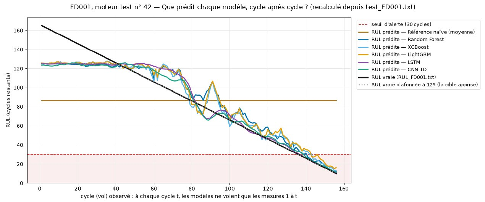

# Aero Predict

> Prédiction de la durée de vie restante (RUL) d'un moteur d'avion, vol par vol, à partir de ses capteurs, pour le retirer avant la panne.

**ML & IA** · En cours · ECE Paris · PPE Technique · ING4 · projet d'équipe · jusqu'en décembre 2026

**RMSE 11,16** sur FD001 (objectif < 18,91)

▶ **[Tester la démo dans le portfolio](https://dorline0121.github.io/#aero-predict)**

## Le projet

Projet de maintenance prédictive en équipe de 6, sur les moteurs NASA C-MAPSS. Surestimer la durée de vie est le cas dangereux : tout le projet est construit pour l'éviter. La démo ci-dessous rejoue les vraies prédictions des 6 modèles sur les 100 moteurs test de FD001, en attendant le prototype complet prévu en décembre.

## Ce que fait le projet

- Comparaison de 6 modèles : arbres (RF, LightGBM, XGBoost) et réseaux (LSTM, CNN 1D)
- Ensemble de 5 LSTM : RMSE de 11,16 au test, contre 19,70 pour XGBoost au départ
- Score NASA divisé par 3,75 en deux mois (852,9 à 227,2)
- Prédiction en 1 à 15 ms, un cycle à la fois ; le modèle ne lit jamais le futur
- Alerte déclenchée à 30 cycles de la panne, validée sur des moteurs jamais vus
- Prototype en cours : démo locale avec Streamlit, explicabilité (SHAP) prévue
- Mon rôle : référente tableau de bord et alertes, tests de la démo « Tester un moteur », relecture des soutenances

## Technologies

`Python` · `PyTorch` · `LSTM` · `XGBoost` · `Optuna` · `Streamlit`

## Fichiers dans ce dépôt

- [`aero.js`](../../aero.js)
- [`assets/aero-data.js`](../../assets/aero-data.js)
- [`assets/aero-predict.jpg`](../../assets/aero-predict.jpg)

---

English version

## Aero Predict

> Predicting the remaining useful life (RUL) of an aircraft engine, flight by flight, from its sensors, so it can be removed before it fails.

*ECE Paris · Technical PPE · Year 4 · team project · running until December 2026*

Predictive maintenance in a team of 6, on NASA C-MAPSS engines. Overestimating remaining life is the dangerous error, and the whole project is built to avoid it. The demo below replays the real predictions of the 6 models on the 100 FD001 test engines, ahead of the full prototype planned for December.

### What it does

- Comparison of 6 models: tree models (RF, LightGBM, XGBoost) and neural networks (LSTM, 1D CNN)
- Ensemble of 5 LSTMs: test RMSE of 11.16, against 19.70 for the first XGBoost
- NASA score divided by 3.75 in two months (852.9 down to 227.2)
- Prediction in 1 to 15 ms, one cycle at a time; the model never reads the future
- Alert raised 30 cycles before failure, checked on engines never seen in training
- Prototype in progress: local Streamlit demo, explainability (SHAP) planned
- My role: dashboard and alerts lead, testing the “Test an engine” demo, reviewing the project reviews

---

Dorline TIAKO OKASSIE · [Portfolio](https://dorline0121.github.io) · [GitHub](https://github.com/Dorline0121)
