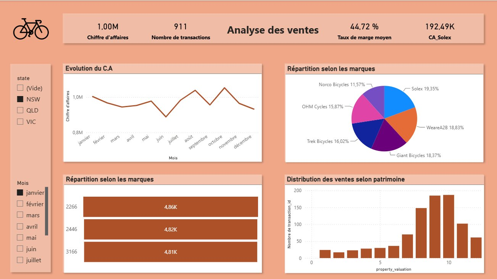

# Analyse des ventes

> Tableau de bord Power BI pour suivre le chiffre d'affaires d'un revendeur de vélos : évolution mensuelle, marques, clients et patrimoine.

**Data & BI** · Terminé · Power BI · données 2017 d'un revendeur de vélos australien

**19 821** transactions analysées

▶ **[Tester la démo dans le portfolio](https://dorline0121.github.io/#analyse-ventes)**

## Le projet

L'objectif : donner à une équipe commerciale une vue d'ensemble de l'année 2017 qu'elle peut filtrer par État et par mois, sans toucher aux données brutes. Le tableau de bord ci-dessous est reconstruit en JavaScript à partir des données du fichier Power BI et réagit aux filtres comme dans Power BI.

## Ce que fait le projet

- Modèle relationnel à trois tables (Transactions, Démographie, Adresses) reliées par l'identifiant client
- Indicateurs clés : chiffre d'affaires, nombre de transactions, taux de marge moyen, CA par marque (mesure DAX)
- Filtres interactifs par État (NSW, QLD, VIC) et par mois
- Évolution du CA, répartition par marque, meilleurs clients et ventes selon le patrimoine

## Technologies

`Power BI` · `DAX` · `Data modeling` · `Data viz`

## Fichiers dans ce dépôt

- [`dashboard.js`](../../dashboard.js)
- [`assets/ventes-data.js`](../../assets/ventes-data.js)
- [`assets/analyse-ventes.jpg`](../../assets/analyse-ventes.jpg)

---

English version

## Sales Analysis

> Power BI dashboard tracking a bike retailer's revenue: monthly trend, brands, customers and property value.

*Power BI · 2017 data from an Australian bike retailer*

The goal: give a sales team an overview of 2017 that they can filter by state and month without touching the raw data. The dashboard below is rebuilt in JavaScript from the Power BI file's data and reacts to filters just like in Power BI.

### What it does

- Relational model with three tables (Transactions, Demographics, Addresses) joined on customer ID
- Key metrics: revenue, transaction count, average margin rate, revenue per brand (DAX measure)
- Interactive slicers by state (NSW, QLD, VIC) and by month
- Revenue trend, brand split, top customers and sales by property valuation

---

Dorline TIAKO OKASSIE · [Portfolio](https://dorline0121.github.io) · [GitHub](https://github.com/Dorline0121)
