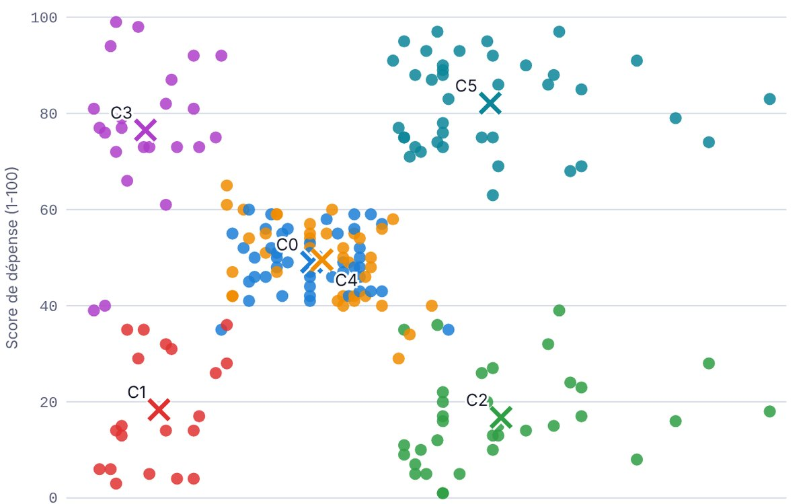

# Introduction au Machine Learning

> Trois labs du cours : descente de gradient codée à la main, validation croisée, métriques et random search « from scratch », prix de BMW d'occasion, classification de vins et segmentation de clients avec K-means.

**ML & IA** · Terminé · ECE Paris · ING4 · Introduction to Machine Learning · octobre 2026 · travail individuel (groupe 01)

**R² 0,849** prix des BMW (Lasso)

▶ **[Tester la démo dans le portfolio](https://dorline0121.github.io/#intro-ml)**

## Le projet

Tout tourne ici, dans le navigateur. La descente de gradient est réentraînée sur les 12 384 logements californiens ; les modèles BMW et vins sont exportés depuis scikit-learn et redonnent exactement les résultats des notebooks (R² 0,8487 pour le Lasso, 45 vins sur 45 pour la Random Forest) ; K-means s'exécute en direct sur les 200 clients.

## Ce que fait le projet

- Régression linéaire par descente de gradient avec pénalité L2, codée avec NumPy, puis grid search sur 36 réglages : MAE de test 0,529 (scikit-learn : 0,530)
- One-hot encoding, MAE, MSE, RMSE et R² recodés à la main ; lecture biais / variance selon le pas, le nombre d'itérations et λ
- Validation croisée k-fold, precision / recall / F1 et random search écrits sans scikit-learn, résultats identiques à la bibliothèque
- Prix de 4 779 BMW d'occasion : nettoyage, âge de la voiture, polynômes, standardisation, one-hot ; régression linéaire, Ridge et Lasso (R² 0,849, erreur ≈ 3 360 €)
- Vins : 6 ratios créés, 4 pipelines sans fuite de données comparés en macro-F1, Random Forest réglée par GridSearchCV (45 / 45 sur le test)
- Clients : K-means sur 4 variables standardisées, k = 6 choisi par le coude et la silhouette (0,425), stabilité vérifiée (ARI = 1), 6 segments et actions marketing

## Concepts importants

- Descente de gradient : gradient de la MSE, taux d'apprentissage, convergence, régularisation L2
- Séparation train / validation / test et validation croisée k-fold (mélange, graine fixe)
- Fuite de données : séparer avant tout fit, transformateurs ajustés sur le train uniquement, pipelines
- Feature engineering : âge, polynômes de degré 2, ratios, one-hot avec catégories rares regroupées
- Ridge (L2) contre Lasso (L1) : le Lasso met des poids exactement à 0 et sélectionne les variables
- Métriques : MAE, RMSE, R² ; matrice de confusion, precision, recall, F1, moyennes macro, AUC
- Recherche d'hyperparamètres : grid search, random search, GridSearchCV sans toucher au test
- Apprentissage non supervisé : K-means, standardisation, méthode du coude, silhouette, ARI

## Problèmes rencontrés et solutions

**Problème :** Avec un pas de 0,001 et 200 itérations, R² de validation de −1,10 : la descente n'a pas convergé.

**Solution :** Grid search sur le pas, les itérations et λ, avec des variables standardisées : lr = 0,1 et 200 itérations suffisent (R² 0,617).

**Problème :** Les fleurs d'Iris sont triées par espèce : sans mélange, chaque pli ne contient qu'une espèce.

**Solution :** Mélange des indices avec une graine fixe, puis np.array_split pour des plis de tailles inégales.

**Problème :** Risque de division par zéro dans precision et recall, et avertissement de non-convergence.

**Solution :** Retour à 0 quand le dénominateur est nul ; max_iter=10000 pour la régression logistique.

**Problème :** Un tirage naïf peut reprendre deux fois la même combinaison, et le même modèle garde ses anciens réglages.

**Solution :** Tirage sans remise parmi les 32 combinaisons et une copie neuve du modèle (clone) à chaque essai.

**Problème :** Données BMW impossibles : kilométrage négatif, puissance nulle, 62 prix sous 1 000 €.

**Solution :** Suppression de ces 64 lignes (4 843 → 4 779 voitures).

**Problème :** Beaucoup de modèles BMW rares, absents du train ou presque.

**Solution :** OneHotEncoder avec min_frequency=10 et handle_unknown="infrequent_if_exist" : ils sont regroupés.

**Problème :** Échelles très différentes (kilomètres ≈ 10⁵, puissance ≈ 10²), alors que Ridge, Lasso et K-means y sont sensibles.

**Solution :** StandardScaler ajusté sur le train seulement, placé dans les pipelines.

**Problème :** Un 0/1 comme le genre, une fois standardisé, ferait couper les clients par genre plutôt que par comportement.

**Solution :** Genre gardé seulement pour décrire les segments ; ajout du ratio dépense / revenu à la place.

**Problème :** Seulement 45 vins en test : une erreur fait perdre 2,2 points, et la Random Forest affiche 100 %.

**Solution :** Validation croisée stratifiée en plus du test, et prudence dans la conclusion.

## Ce que j'ai appris

- Recoder un algorithme est le meilleur moyen de comprendre ce que fait vraiment la bibliothèque
- Le pas et le nombre d'itérations comptent autant que le modèle lui-même
- Choisir la métrique avant de comparer : l'accuracy seule cache des erreurs sur les petites classes
- La régularisation rend un modèle plus simple et plus stable, au prix d'un peu de biais
- Sans étiquettes, un choix de k se justifie par plusieurs critères et par l'utilité métier
- Un score parfait sur un petit test reste à confirmer par validation croisée

## Technologies

`Python` · `NumPy` · `pandas` · `scikit-learn` · `Matplotlib` · `Seaborn` · `Jupyter`

## Fichiers dans ce dépôt

- [`intro-ml.js`](../../intro-ml.js)
- [`assets/intro-ml-data.js`](../../assets/intro-ml-data.js)
- [`assets/intro-ml-cal.js`](../../assets/intro-ml-cal.js)
- [`assets/intro-ml.jpg`](../../assets/intro-ml.jpg)

---

English version

## Introduction to Machine Learning

> Three labs from the course: hand-coded gradient descent, cross-validation, metrics and random search from scratch, used BMW prices, wine classification and customer segmentation with K-means.

*ECE Paris · Year 4 · Introduction to Machine Learning · October 2026 · individual work (group 01)*

Everything runs here, in the browser. Gradient descent is retrained on the 12,384 Californian homes; the BMW and wine models are exported from scikit-learn and give exactly the notebook results (R² 0.8487 for the Lasso, 45 of 45 wines for the Random Forest); K-means runs live on the 200 customers.

### What it does

- Linear regression by gradient descent with an L2 penalty, coded with NumPy, then grid search over 36 settings: test MAE 0.529 (scikit-learn: 0.530)
- One-hot encoding, MAE, MSE, RMSE and R² recoded by hand; bias / variance reading by step size, iterations and λ
- k-fold cross-validation, precision / recall / F1 and random search written without scikit-learn, same results as the library
- Prices of 4,779 used BMWs: cleaning, car age, polynomials, scaling, one-hot; linear regression, Ridge and Lasso (R² 0.849, error ≈ €3,360)
- Wines: 6 engineered ratios, 4 leakage-safe pipelines compared on macro-F1, Random Forest tuned with GridSearchCV (45 / 45 on the test set)
- Customers: K-means on 4 standardised features, k = 6 chosen by elbow and silhouette (0.425), stability checked (ARI = 1), 6 segments and marketing actions

### Key concepts

- Gradient descent: MSE gradient, learning rate, convergence, L2 regularisation
- Train / validation / test split and k-fold cross-validation (shuffle, fixed seed)
- Data leakage: split before any fit, transformers fitted on the training set only, pipelines
- Feature engineering: age, degree-2 polynomials, ratios, one-hot with rare categories grouped
- Ridge (L2) vs Lasso (L1): the Lasso sets weights exactly to 0 and selects features
- Metrics: MAE, RMSE, R²; confusion matrix, precision, recall, F1, macro averages, AUC
- Hyperparameter search: grid search, random search, GridSearchCV without touching the test set
- Unsupervised learning: K-means, scaling, elbow method, silhouette, ARI

### Problems met and solutions

- **Problem:** With a step of 0.001 and 200 iterations, validation R² of −1.10: gradient descent had not converged.  
  **Solution:** Grid search over the step, iterations and λ, with standardised features: lr = 0.1 and 200 iterations are enough (R² 0.617).
- **Problem:** The Iris flowers are sorted by species: without shuffling, each fold holds a single species.  
  **Solution:** Indices shuffled with a fixed seed, then np.array_split for folds of unequal size.
- **Problem:** Risk of division by zero in precision and recall, and a non-convergence warning.  
  **Solution:** Return 0 when the denominator is zero; max_iter=10000 for logistic regression.
- **Problem:** A naive draw can pick the same combination twice, and a reused model keeps its old settings.  
  **Solution:** Draw without replacement among the 32 combinations and a fresh copy of the model (clone) for each trial.
- **Problem:** Impossible BMW records: negative mileage, zero power, 62 prices below €1,000.  
  **Solution:** These 64 rows removed (4,843 → 4,779 cars).
- **Problem:** Many rare BMW models, absent or almost absent from the training set.  
  **Solution:** OneHotEncoder with min_frequency=10 and handle_unknown="infrequent_if_exist": they are grouped.
- **Problem:** Very different scales (km ≈ 10⁵, power ≈ 10²), while Ridge, Lasso and K-means are sensitive to them.  
  **Solution:** StandardScaler fitted on the training set only, inside the pipelines.
- **Problem:** A 0/1 feature like gender, once standardised, would make K-means split customers by gender instead of behaviour.  
  **Solution:** Gender kept only to describe the segments; the spending / income ratio added instead.
- **Problem:** Only 45 test wines: one error costs 2.2 points, and the Random Forest shows 100%.  
  **Solution:** Stratified cross-validation on top of the test set, and a cautious conclusion.

### What I learned

- Recoding an algorithm is the best way to understand what the library really does
- The step size and the number of iterations matter as much as the model itself
- Choose the metric before comparing: accuracy alone hides errors on small classes
- Regularisation makes a model simpler and more stable, at the cost of a little bias
- Without labels, a choice of k is justified by several criteria and by business usefulness
- A perfect score on a small test set still has to be confirmed by cross-validation

---

Dorline TIAKO OKASSIE · [Portfolio](https://dorline0121.github.io) · [GitHub](https://github.com/Dorline0121)
