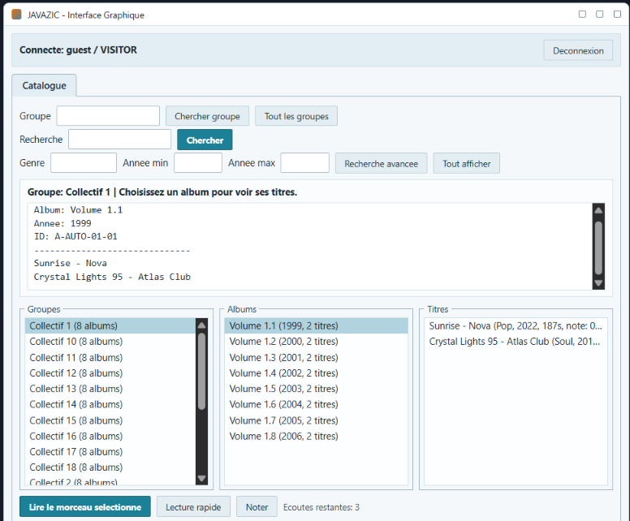

# JAVAZIC

> Application Java de catalogue musical et de playlists, façon Spotify, avec interface Swing et trois profils : visiteur, abonné, administrateur.

**Logiciel** · Terminé · ECE Paris · Programmation orientée objet · soutenance avril 2026 · projet d'équipe

**MVC** architecture

▶ **[Tester la démo dans le portfolio](https://dorline0121.github.io/#javazic)**

## Le projet

L'application d'origine est en Java (Swing). Pour l'utiliser ici, je l'ai réécrite en JavaScript à partir du même code : mêmes comptes de démonstration, même catalogue, mêmes règles par profil. Connectez-vous avec guest/guest, alice/alice ou admin/admin.

## Ce que fait le projet

- Architecture MVC
- Interface graphique Swing : connexion, catalogue, playlists, historique, administration, statistiques
- Navigation groupe → album → titres, recherche simple et avancée (genre, période), notes et avis
- Trois profils : visiteur (3 écoutes), abonné (playlists, historique), administrateur
- Sauvegarde de l'état par sérialisation Java

## Technologies

`Java` · `Swing` · `MVC` · `POO`

## Comptes de démonstration

| Identifiant | Mot de passe |
|---|---|
| guest | guest |
| alice | alice |
| bob | bob |
| admin | admin |

## Fichiers dans ce dépôt

- [`javazic.js`](../../javazic.js)
- [`assets/javazic.png`](../../assets/javazic.png)

---

English version

## JAVAZIC

> A Spotify-style Java app for a music catalogue and playlists, with a Swing interface and three profiles: visitor, subscriber, admin.

*ECE Paris · Object-oriented programming · presented April 2026 · team project*

The original app is written in Java (Swing). To use it here, I rewrote it in JavaScript from the same code: same demo accounts, same catalogue, same rules per profile. Log in with guest/guest, alice/alice or admin/admin.

### What it does

- MVC architecture
- Swing interface: login, catalogue, playlists, history, admin, statistics
- Group → album → track browsing, simple and advanced search (genre, period), ratings and reviews
- Three profiles: visitor (3 plays), subscriber (playlists, history), admin
- State saved with Java serialization

---

Dorline TIAKO OKASSIE · [Portfolio](https://dorline0121.github.io) · [GitHub](https://github.com/Dorline0121)
