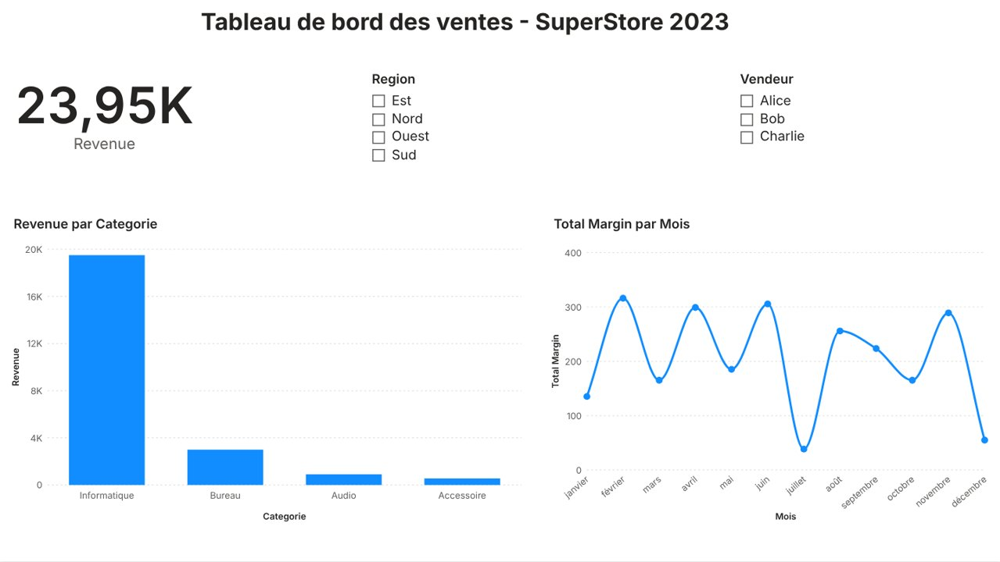

# Tableau de bord SuperStore

> Lab Power BI : d'un fichier brut mal formé à un tableau de bord interactif de deux pages, avec mesures DAX, segments et treemap à couleurs conditionnelles.

**Data & BI** · Terminé · ECE Paris · ING4 · Lab 7 Business Intelligence · 18 novembre 2026 · travail individuel

**23,95K** de ventes analysées, 50 commandes 2023

▶ **[Tester la démo dans le portfolio](https://dorline0121.github.io/#lab7-superstore)**

## Le projet

Toute la chaîne BI sur un petit jeu de ventes : importer et nettoyer les données avec Power Query, créer des mesures DAX, construire les visuels, ajouter des filtres puis raconter ce que montrent les chiffres. Ci-dessous, le rapport reconstruit en JavaScript à partir du fichier .pbix et des données d'origine : les deux pages, la table, les étapes Power Query et les mesures.

## Ce que fait le projet

- Nettoyage dans Power Query : fractionnement d'une colonne unique en 8 colonnes, en-têtes, types de données avec paramètres régionaux
- Mesures DAX Revenue et Total Margin, recalculées selon les filtres
- Page 1 : carte KPI, histogramme par catégorie, courbe mensuelle de la marge, segments Region et Vendeur
- Page 2 : treemap de la marge par région avec dégradé conditionnel rouge / gris / vert et analyse écrite pour le directeur
- Rapport de lab rédigé avec captures, tableaux de référence et conclusion

## Concepts importants

- ETL avec Power Query : transformer avant de charger, chaque étape est enregistrée et rejouable
- Types de données et paramètres régionaux : un séparateur décimal mal lu fausse tous les calculs
- Mesure DAX contre colonne : une mesure s'adapte au contexte de filtre
- Hiérarchie de dates : choisir le bon niveau (mois plutôt que jour) pour lire une tendance
- Segments et interactions : filtrer tous les visuels d'un clic
- Mise en forme conditionnelle : une couleur doit avoir un sens métier (rouge = perte)
- Storytelling : conclure par une analyse claire pour la direction

## Problèmes rencontrés et solutions

**Problème :** Toutes les valeurs d'une commande dans une seule cellule (Column1).

**Solution :** Fractionner la colonne par délimiteur (virgule, à chaque occurrence) : 8 colonnes.

**Problème :** En-têtes promus deux fois : la première commande devenait l'en-tête, il ne restait que 49 lignes.

**Solution :** Suppression de l'étape en trop dans « Étapes appliquées ».

**Problème :** Power BI en français lit 1200.50 comme 120050.

**Solution :** Type modifié avec paramètres régionaux Anglais (États-Unis) pour Ventes et Profit.

**Problème :** Confusion entre le visuel « Map » (carte géographique) et la carte KPI « 123 ».

**Solution :** Utilisation du visuel Carte (Card) pour afficher Revenue.

**Problème :** Courbe en « électrocardiogramme » avec l'axe des dates au jour.

**Solution :** Garder seulement le niveau Mois de la hiérarchie de dates : 12 points lisibles.

**Problème :** Le dégradé par défaut colorait l'Est en rouge alors qu'il est rentable.

**Solution :** Minimum personnalisé à −900, centre à 0 en gris : le rouge signifie vraiment une perte.

## Ce que j'ai appris

- Vérifier les données dès l'import : le nombre de lignes et les types évitent des erreurs invisibles plus tard
- Préférer des mesures DAX aux colonnes brutes pour un tableau de bord vraiment interactif
- Une visualisation doit être réglée pour dire la vérité : niveau de date, échelle de couleurs
- Lire les chiffres : 81 % des ventes en Informatique, le Sud est la région la plus rentable, l'Est la plus fragile, et les pertes viennent de la catégorie Bureau (−190 €), pas d'une région

## Technologies

`Power BI Desktop` · `Power Query` · `DAX` · `Excel`

## Fichiers dans ce dépôt

- [`superstore.js`](../../superstore.js)
- [`assets/superstore.jpg`](../../assets/superstore.jpg)

---

English version

## SuperStore Dashboard

> Power BI lab: from a badly formatted raw file to a two-page interactive dashboard, with DAX measures, slicers and a treemap with conditional colours.

*ECE Paris · Year 4 · Lab 7 Business Intelligence · 18 November 2026 · individual work*

The whole BI chain on a small sales dataset: import and clean the data with Power Query, create DAX measures, build the visuals, add filters, then tell what the numbers show. Below, the report rebuilt in JavaScript from the .pbix file and the original data: both pages, the table, the Power Query steps and the measures.

### What it does

- Cleaning in Power Query: one column split into 8, headers, data types with locale
- DAX measures Revenue and Total Margin, recalculated with the filters
- Page 1: KPI card, column chart by category, monthly margin line, Region and Vendeur slicers
- Page 2: margin treemap by region with a red / grey / green conditional gradient and a written analysis for the director
- Lab report with screenshots, reference tables and conclusion

### Key concepts

- ETL with Power Query: transform before loading, every step is recorded and replayable
- Data types and locale: a misread decimal separator breaks every calculation
- DAX measure vs column: a measure adapts to the filter context
- Date hierarchy: pick the right level (month rather than day) to read a trend
- Slicers and interactions: filter every visual in one click
- Conditional formatting: a colour must carry business meaning (red = loss)
- Storytelling: end with a clear analysis for management

### Problems met and solutions

- **Problem:** All the values of an order in a single cell (Column1).  
  **Solution:** Split column by delimiter (comma, each occurrence): 8 columns.
- **Problem:** Headers promoted twice: the first order became the header and only 49 rows remained.  
  **Solution:** Deleted the extra step in “Applied steps”.
- **Problem:** Power BI with French settings reads 1200.50 as 120050.  
  **Solution:** Changed type with locale English (United States) for Ventes and Profit.
- **Problem:** Confusion between the geographic “Map” visual and the “123” KPI card.  
  **Solution:** Used the Card visual to show Revenue.
- **Problem:** An “electrocardiogram” line with a daily date axis.  
  **Solution:** Kept only the Month level of the date hierarchy: 12 readable points.
- **Problem:** The default gradient coloured the East red although it is profitable.  
  **Solution:** Custom minimum at −900, centre at 0 in grey: red now really means a loss.

### What I learned

- Check the data right at import: row counts and types prevent invisible errors later
- Prefer DAX measures over raw columns for a truly interactive dashboard
- A visual must be tuned to tell the truth: date level, colour scale
- Reading the numbers: 81% of sales in Informatique, the South is the most profitable region, the East the weakest, and losses come from the Bureau category (−€190), not from a region

---

Dorline TIAKO OKASSIE · [Portfolio](https://dorline0121.github.io) · [GitHub](https://github.com/Dorline0121)
