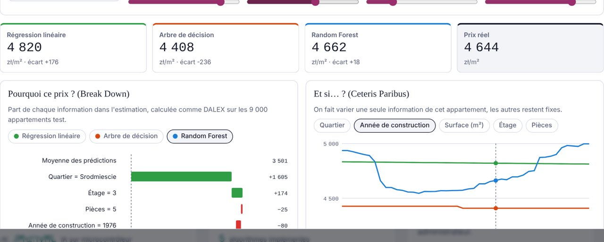

# Machine Learning en Python

> Quatre labs du cours Data Science with Python : expliquer un modèle de prix avec DALEX, scorer un risque de crédit, comprendre ce qu'apporte un réseau de neurones et le régulariser.

**ML & IA** · Terminé · ECE Paris · ING4 · Data Science with Python (Mme Laure Normand) · novembre 2026 · travail individuel

**R² 0,978** meilleur modèle (MLP régularisé)

▶ **[Tester la démo dans le portfolio](https://dorline0121.github.io/#labs-data-science)**

## Le projet

Les modèles d'appartements tournent ici à l'identique : je les ai exportés depuis scikit-learn et ils redonnent exactement les prédictions du notebook (4 820, 4 408 et 4 662 zł/m² pour le client du TP). Les explications DALEX se recalculent pour chaque appartement.

## Ce que fait le projet

- DALEX sur les prix au m² à Varsovie : importance des variables, profils, Break Down et « et si ? » pour expliquer une estimation à un client
- Comparaison régression linéaire, arbre de décision et Random Forest : erreur divisée par 2,6, et l'effet en U de l'année de construction retrouvé
- Scoring de crédit (German Credit) : 7 modèles en validation croisée à 5 plis, choix guidé par le recall, le F1 et l'écart train-test
- Neurone seul contre MLP sur make_moons : 0,84 contre 0,95 de précision, et le détail des 337 paramètres
- MLP Keras sur données tabulaires : surapprentissage visible sur les courbes, corrigé par dropout et early stopping
- Une présentation DALEX pour une agence immobilière, en français et en anglais

## Concepts importants

- Explicabilité (XAI) avec DALEX : importance par permutation, profils de dépendance partielle, Break Down, Ceteris Paribus
- Compromis biais / variance : profondeur d'un arbre, écart entre score d'entraînement et de test
- Méthodes d'ensemble : bagging (Random Forest) et boosting (XGBoost)
- Classes déséquilibrées : precision, recall, F1 et AUC plutôt que l'accuracy ; class_weight="balanced"
- Validation croisée stratifiée à 5 plis
- Réseaux de neurones : couches cachées, ReLU, rétropropagation, optimiseur Adam, nombre de paramètres
- Régularisation : dropout et early stopping ; mise à l'échelle des entrées et de la cible

## Problèmes rencontrés et solutions

**Problème :** La régression linéaire ignore l'année de construction (importance ≈ 0), alors que les prix réels forment un U.

**Solution :** Arbre et Random Forest, expliqués avec DALEX : ils retrouvent le U, et l'erreur passe de 263 à 101 zł/m².

**Problème :** Un arbre sans limite apprend par cœur : erreur nulle en entraînement, la pire en test.

**Solution :** Choix de la profondeur en comparant les scores d'entraînement et de test (profondeur 4 pour le crédit, 10 pour les appartements).

**Problème :** 70 % de bons payeurs : l'accuracy est trompeuse et la Random Forest ne détecte que 37 % des mauvais payeurs.

**Solution :** Recall, F1 et AUC comme critères, et class_weight="balanced".

**Problème :** Comparaison injuste : seule la Random Forest était équilibrée.

**Solution :** Même réglage appliqué à la régression logistique, qui devient la meilleure (recall 0,720, F1 0,606).

**Problème :** Un neurone seul plafonne à 0,84 sur les deux lunes.

**Solution :** Deux couches cachées de 16 neurones (ReLU) : frontière courbe, 0,95.

**Problème :** Le MLP surapprend après l'époque 33.

**Solution :** Dropout 0,2 et early stopping (patience 20) : erreur réduite de 37 %.

**Problème :** La sortie TanH ne produit que des valeurs entre −1 et 1.

**Solution :** Prix mis à l'échelle entre −1 et 1 pour l'entraînement, puis reconverti en złoty pour l'évaluation.

## Ce que j'ai appris

- Un modèle plus complexe n'est pas forcément meilleur, surtout sur un petit jeu de données
- Comparer des modèles dans les mêmes conditions avant de conclure
- Sur des données déséquilibrées, l'AUC seule ne suffit pas : il faut regarder le recall et le F1
- L'explicabilité permet d'utiliser un modèle plus performant tout en justifiant ses décisions
- Sur de petites données tabulaires, les modèles classiques restent très compétitifs face aux réseaux de neurones

## Technologies

`Python` · `scikit-learn` · `DALEX` · `Keras` · `XGBoost` · `pandas`

## Fichiers dans ce dépôt

- [`labs-ds.js`](../../labs-ds.js)
- [`assets/varsovie-data.js`](../../assets/varsovie-data.js)
- [`assets/varsovie-rf.js`](../../assets/varsovie-rf.js)
- [`assets/varsovie-tree.js`](../../assets/varsovie-tree.js)
- [`assets/mlp-courbes-avec.png`](../../assets/mlp-courbes-avec.png)
- [`assets/mlp-courbes-sans.png`](../../assets/mlp-courbes-sans.png)
- [`assets/labs-ds.jpg`](../../assets/labs-ds.jpg)

---

English version

## Machine Learning in Python

> Four labs from the Data Science with Python course: explain a price model with DALEX, score credit risk, understand what a neural network adds and regularise it.

*ECE Paris · Year 4 · Data Science with Python (Mrs Laure Normand) · November 2026 · individual work*

The apartment models run here identically: I exported them from scikit-learn and they give exactly the notebook's predictions (4,820, 4,408 and 4,662 zł/m² for the lab client). The DALEX explanations recalculate for every apartment.

### What it does

- DALEX on Warsaw prices per m²: feature importance, profiles, Break Down and what-if to explain an estimate to a client
- Linear regression vs decision tree vs Random Forest: error divided by 2.6, and the U-shaped effect of the construction year recovered
- Credit scoring (German Credit): 7 models with 5-fold cross-validation, chosen on recall, F1 and train-test gap
- Single neuron vs MLP on make_moons: 0.84 vs 0.95 accuracy, and the breakdown of the 337 parameters
- Keras MLP on tabular data: overfitting visible on the curves, fixed with dropout and early stopping
- A DALEX presentation for a real-estate agency, in French and English

### Key concepts

- Explainability (XAI) with DALEX: permutation importance, partial dependence profiles, Break Down, Ceteris Paribus
- Bias / variance trade-off: tree depth, gap between training and test scores
- Ensemble methods: bagging (Random Forest) and boosting (XGBoost)
- Imbalanced classes: precision, recall, F1 and AUC instead of accuracy; class_weight="balanced"
- Stratified 5-fold cross-validation
- Neural networks: hidden layers, ReLU, backpropagation, Adam optimizer, parameter count
- Regularisation: dropout and early stopping; scaling of inputs and target

### Problems met and solutions

- **Problem:** Linear regression ignores the construction year (importance ≈ 0), while real prices form a U.  
  **Solution:** Tree and Random Forest, explained with DALEX: they recover the U, and the error drops from 263 to 101 zł/m².
- **Problem:** An unlimited tree learns by heart: zero training error, the worst test error.  
  **Solution:** Depth chosen by comparing training and test scores (depth 4 for credit, 10 for apartments).
- **Problem:** 70% good payers: accuracy is misleading and the Random Forest only detects 37% of bad payers.  
  **Solution:** Recall, F1 and AUC as criteria, and class_weight="balanced".
- **Problem:** Unfair comparison: only the Random Forest was balanced.  
  **Solution:** Same setting applied to logistic regression, which becomes the best (recall 0.720, F1 0.606).
- **Problem:** A single neuron plateaus at 0.84 on the two moons.  
  **Solution:** Two hidden layers of 16 neurons (ReLU): curved boundary, 0.95.
- **Problem:** The MLP overfits after epoch 33.  
  **Solution:** Dropout 0.2 and early stopping (patience 20): error cut by 37%.
- **Problem:** The TanH output only produces values between −1 and 1.  
  **Solution:** Price scaled to [−1, 1] for training, converted back to złoty for evaluation.

### What I learned

- A more complex model is not always better, especially on a small dataset
- Compare models under the same conditions before concluding
- On imbalanced data, AUC alone is not enough: look at recall and F1
- Explainability makes it possible to use a stronger model while justifying its decisions
- On small tabular data, classical models remain very competitive against neural networks

---

Dorline TIAKO OKASSIE · [Portfolio](https://dorline0121.github.io) · [GitHub](https://github.com/Dorline0121)
