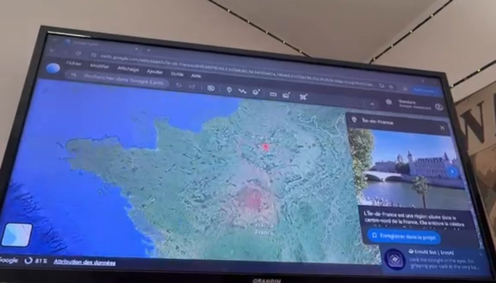

# Neural Speech

> Commande vocale embarquée : on appuie sur un bouton, on dit « Paris », « Togo », « Cameroun » ou « Ivoire », et Google Earth s'envole vers la destination.

**ML & IA · Embarqué** · Terminé · ECE Paris · ING3 · projet d'électronique embarquée (S6) · équipe de 5

**≈ 93 %** mots reconnus (validation croisée)

▶ **[Tester la démo dans le portfolio](https://dorline0121.github.io/#neural-speech)**

## Le projet

Toute la chaîne est faite par l'équipe : acquisition du son sur Arduino Due, filtrage, décimation, MFCC, réseau de neurones et pilotage de Google Earth. La vidéo montre le résultat final. En dessous, la reconnaissance tourne ici sur de vrais enregistrements du projet, avec les mêmes calculs et les mêmes poids, qui redonnent exactement les sorties du modèle Python.

## Ce que fait le projet

- Acquisition à 32 kHz par timer et ADC 12 bits, micro MAX9814, restitution par le DAC validée à l'oscilloscope
- Filtre passe-bas biquad anti-repliement : −73,6 dB vers 3,8 kHz (exigence −30 dB), puis décimation 32 → 8 kHz
- Dataset de 4 mots enregistré avec notre montage : 200 fichiers WAV d'une seconde (50 par mot)
- MFCC (13 coefficients × 32 trames) harmonisés entre Python et l'Arduino, MLP 416 → 64 → 32 → 4 exporté en C (model.h)
- Intégration : bouton et LED sur l'Arduino, liaison série vers Python, navigation Google Earth avec Selenium
- Livrables : planning Gantt, architectures, audit FP1 à FP6, soutenances devant jury

## Concepts importants

- Échantillonnage et théorème de Nyquist-Shannon : 32 kHz pour capter, 8 kHz pour une voix limitée à 4 kHz
- Filtrage numérique IIR (biquad) et repliement de spectre
- Décimation et économie de mémoire sur microcontrôleur
- MFCC : pré-accentuation, fenêtre de Hamming, FFT, banc de filtres Mel, log et DCT
- Perceptron multicouche (ReLU, softmax) et export des poids vers du C
- Interruption timer, buffers et liaison série (UART) entre l'Arduino et le PC

## Problèmes rencontrés et solutions

**Problème :** Dérive entre le signal d'entrée et le signal restitué par le DAC.

**Solution :** Timer recalibré (RC = 1313 pour ≈ 32 kHz) et vérification par les logs série et l'oscilloscope.

**Problème :** Atténuation insuffisante du premier filtre.

**Solution :** Coefficients du biquad recalculés en Python, puis validés dans Audacity : −73,6 dB vers 3,8 kHz.

**Problème :** Artefacts audio après le sous-échantillonnage.

**Solution :** Filtre passe-bas appliqué avant la décimation.

**Problème :** Les MFCC calculés en Python et sur l'Arduino ne donnaient pas les mêmes vecteurs.

**Solution :** Paramètres harmonisés (FFT 512, pas de 256, 26 filtres Mel, 13 coefficients) et même algorithme des deux côtés.

**Problème :** Erreurs d'arrondi en convertissant les poids du réseau en C.

**Solution :** Script d'export dédié qui génère model.h automatiquement depuis l'entraînement.

**Problème :** Seulement 40 enregistrements par mot au lieu des 50 demandés.

**Solution :** Enregistrements complétés par de l'augmentation de données, puis classes équilibrées à 50 exemples.

**Problème :** Le cahier des charges recommandait un buffer circulaire.

**Solution :** Buffer statique d'une seconde, suffisant pour des commandes courtes ; testé sans débordement sur 20 acquisitions consécutives.

**Problème :** Selenium n'arrivait pas à piloter Google Earth.

**Solution :** Chrome lancé avec le port de débogage 9222 et procédure de lancement documentée.

## Ce que j'ai appris

- Valider chaque étape avec une mesure (oscilloscope, spectre) avant de passer à la suivante
- Un modèle embarqué impose des choix de mémoire et de calcul dès l'acquisition
- Le prétraitement doit être identique à l'entraînement et sur la carte
- Documenter les écarts au cahier des charges et les justifier par des tests
- Travailler en équipe de 5 avec un planning et des jalons de soutenance

## Technologies

`Arduino Due` · `C++` · `Python` · `scikit-learn` · `librosa` · `Selenium` · `Audacity` · `Oscilloscope`

## Fichiers dans ce dépôt

- [`neural-speech.js`](../../neural-speech.js)
- [`assets/neural-speech-data.js`](../../assets/neural-speech-data.js)
- [`assets/neural-speech-demo.mp4`](../../assets/neural-speech-demo.mp4)
- [`assets/neural-speech-poster.jpg`](../../assets/neural-speech-poster.jpg)
- [`assets/neural-speech.jpg`](../../assets/neural-speech.jpg)
- `assets/ns-*.jpg`

---

English version

## Neural Speech

> Embedded voice command: press a button, say “Paris”, “Togo”, “Cameroun” or “Ivoire”, and Google Earth flies to the destination.

*ECE Paris · Year 3 · embedded electronics project (S6) · team of 5*

The team built the whole chain: sound capture on an Arduino Due, filtering, decimation, MFCC, neural network and Google Earth control. The video shows the final result. Below, the recognition runs here on real project recordings, with the same computations and weights, giving exactly the Python model's outputs.

### What it does

- 32 kHz capture with a timer and 12-bit ADC, MAX9814 microphone, DAC playback validated on the oscilloscope
- Anti-aliasing biquad low-pass filter: −73.6 dB around 3.8 kHz (requirement −30 dB), then decimation 32 → 8 kHz
- 4-word dataset recorded with our circuit: 200 one-second WAV files (50 per word)
- MFCC (13 coefficients × 32 frames) matched between Python and the Arduino, 416 → 64 → 32 → 4 MLP exported to C (model.h)
- Integration: button and LED on the Arduino, serial link to Python, Google Earth navigation with Selenium
- Deliverables: Gantt plan, architectures, FP1 to FP6 audit, jury presentations

### Key concepts

- Sampling and the Nyquist-Shannon theorem: 32 kHz to capture, 8 kHz for a voice limited to 4 kHz
- IIR digital filtering (biquad) and aliasing
- Decimation and memory savings on a microcontroller
- MFCC: pre-emphasis, Hamming window, FFT, Mel filter bank, log and DCT
- Multilayer perceptron (ReLU, softmax) and exporting the weights to C
- Timer interrupts, buffers and serial link (UART) between the Arduino and the PC

### Problems met and solutions

- **Problem:** Drift between the input signal and the DAC output.  
  **Solution:** Timer recalibrated (RC = 1313 for ≈ 32 kHz) and checked with serial logs and the oscilloscope.
- **Problem:** The first filter did not attenuate enough.  
  **Solution:** Biquad coefficients recomputed in Python, then validated in Audacity: −73.6 dB around 3.8 kHz.
- **Problem:** Audio artefacts after downsampling.  
  **Solution:** Low-pass filter applied before decimation.
- **Problem:** MFCCs computed in Python and on the Arduino gave different vectors.  
  **Solution:** Parameters matched (512 FFT, hop 256, 26 Mel filters, 13 coefficients) and the same algorithm on both sides.
- **Problem:** Rounding errors when converting the network weights to C.  
  **Solution:** Dedicated export script that generates model.h automatically from training.
- **Problem:** Only 40 recordings per word instead of the required 50.  
  **Solution:** Recordings completed with data augmentation, then classes balanced at 50 examples.
- **Problem:** The specification recommended a circular buffer.  
  **Solution:** One-second static buffer, enough for short commands; tested without overflow over 20 consecutive captures.
- **Problem:** Selenium could not drive Google Earth.  
  **Solution:** Chrome started with debugging port 9222 and a documented launch procedure.

### What I learned

- Validate each step with a measurement (oscilloscope, spectrum) before moving to the next
- An embedded model forces memory and compute choices from the capture stage onwards
- Preprocessing must be identical at training time and on the board
- Document deviations from the specification and justify them with tests
- Work in a team of 5 with a plan and presentation milestones

---

Dorline TIAKO OKASSIE · [Portfolio](https://dorline0121.github.io) · [GitHub](https://github.com/Dorline0121)
