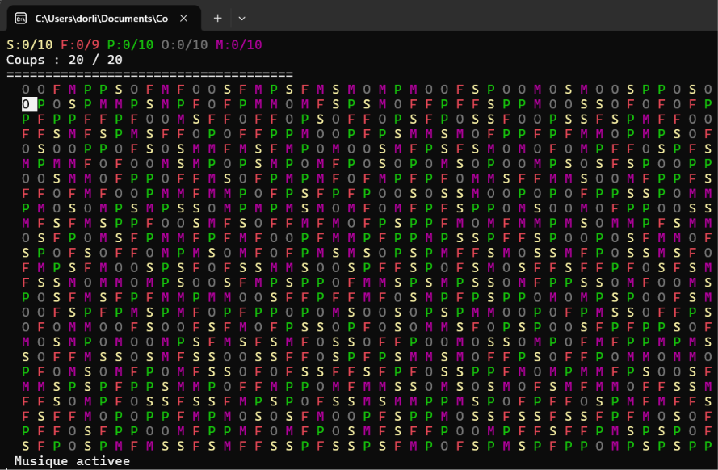

# Plantamitz

> Jeu de plateau en C inspiré des jeux « match-3 » : remplir un contrat de collecte de fruits et légumes en un nombre limité de coups.

**Logiciel** · Terminé · ECE Paris · Programmation en C · projet de groupe

**25 × 45** cases par plateau

▶ **[Tester la démo dans le portfolio](https://dorline0121.github.io/#plantamitz)**

## Le projet

Le jeu original est écrit en C pour la console Windows. Pour pouvoir y jouer ici, je l'ai réécrit en JavaScript à partir du même code : mêmes règles, mêmes contrats, mêmes touches. Cliquez dans la console puis utilisez le clavier, ou touchez les cases sur téléphone.

## Ce que fait le projet

- Génération aléatoire du plateau qui refuse les alignements interdits (horizontal, vertical, carré 2×2, figure en H)
- Gestion des contrats par niveau, avec compteur d'items restants et de coups restants
- Vérification automatique de l'état du contrat : réussi, en cours ou échoué
- Détection des alignements au clavier (Z, Q, S, D) et affichage coloré en console
- Bonus : musique d'introduction et bombes qui modifient les alignements

## Technologies

`C` · `JavaScript` · `Algorithmes` · `Projet de groupe`

## Fichiers dans ce dépôt

- [`plantamitz.js`](../../plantamitz.js)
- [`assets/plantamitz-musique.mp3`](../../assets/plantamitz-musique.mp3)
- [`assets/plantamitz-demo.mp4`](../../assets/plantamitz-demo.mp4)
- [`assets/plantamitz-poster.jpg`](../../assets/plantamitz-poster.jpg)
- [`assets/plantamitz.png`](../../assets/plantamitz.png)

---

English version

## Plantamitz

> A match-3 style board game written in C: fill a contract for fruits and vegetables within a limited number of moves.

*ECE Paris · C programming · team project*

The original game is written in C for the Windows console. To make it playable here, I rewrote it in JavaScript from the same code: same rules, same contracts, same keys. Click inside the console and use the keyboard, or tap the cells on a phone.

### What it does

- Random board generation that rejects forbidden patterns (horizontal, vertical, 2×2 square, H shape)
- Contracts per level, with counters for items and moves left
- Automatic contract status check: success, in progress or failed
- Pattern detection from the keyboard (Z, Q, S, D) and coloured console display
- Bonus: intro music and bombs that change the matches

---

Dorline TIAKO OKASSIE · [Portfolio](https://dorline0121.github.io) · [GitHub](https://github.com/Dorline0121)
