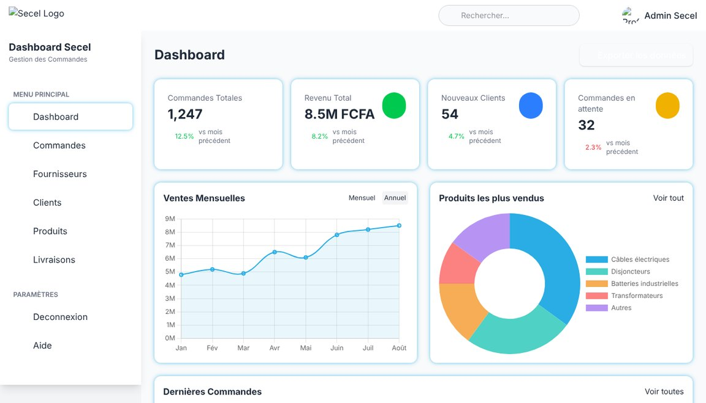

# SECEL Commandes

> Boutique en ligne et gestion des commandes, avec suivi des livraisons sur une carte du Cameroun. Le client commande et suit son colis ; l'administrateur gère commandes, stock et livraisons.

**Logiciel** · Terminé · BTS Génie Logiciel · projet de ma camarade Lauwa Lesly, que j'ai remis en route et enrichi

**22 villes** livrées depuis Douala

▶ **[Tester la démo dans le portfolio](https://dorline0121.github.io/#secel-commandes)**

## Le projet

Le projet d'origine est celui de Lauwa : une boutique et un tableau de bord d'administration. Il ne fonctionnait plus faute de base de données. Je l'ai reconstruite, j'ai corrigé les bugs et j'ai ajouté une carte de suivi des livraisons au Cameroun. La démo affiche les vraies pages de l'application, enregistrées depuis XAMPP : passez une commande en tant que client, puis connectez-vous en admin et faites avancer le colis de ville en ville dans la section Livraisons.

## Ce que fait le projet

- Client : catalogue, panier, commande avec ville de livraison et paiement Orange Money ou MTN Mobile Money
- Code de suivi et page de suivi : carte, étapes, position du colis, date prévue, livreur, historique
- Admin : chiffre d'affaires, commandes, clients, produits avec alertes de stock
- Livraisons : carte de toutes les livraisons, filtre par statut, bouton « Étape suivante », attribution du livreur
- Itinéraires réels par les grandes villes (Douala → Edéa → Yaoundé → Bafia → Ngaoundéré → Garoua…) et distance estimée
- La commande suit automatiquement le statut de sa livraison

## Concepts importants

- Rôles enregistrés à l'inscription (user / admin) et redirection selon le rôle à la connexion
- PDO et requêtes préparées, mots de passe hachés avec password_hash()
- Modèle de données : clients, produits, commandes, fournisseurs, livraisons et historique
- Machine à états d'une livraison : Confirmée → En préparation → Expédiée → En transit → Arrivée en ville → Livrée
- Cartographie : coordonnées GPS des villes, itinéraires, distance de Haversine, carte Leaflet / OpenStreetMap
- Migration SQL qui ajoute des tables sans effacer les données existantes

## Problèmes rencontrés et solutions

**Problème :** Aucun fichier SQL n'était fourni : l'application ne pouvait pas démarrer.

**Solution :** Base gestion_commandes reconstruite à partir de toutes les requêtes du code, avec des données de démonstration.

**Problème :** Un message était affiché avant la redirection de connexion (« headers already sent ») : la redirection pouvait échouer.

**Solution :** Message retiré, session ouverte avant toute sortie.

**Problème :** Le tableau de bord utilisait la liste des clients avant de l'avoir chargée.

**Solution :** Données chargées en haut de la page, avec contrôle du rôle admin.

**Problème :** Le formulaire « Nouvelle commande » envoyait vers un fichier qui n'existait pas.

**Solution :** add_commande.php créé : commande enregistrée, stock décrémenté, livraison créée.

**Problème :** La carte de livraison du tableau de bord n'affichait que des points factices.

**Solution :** Vraie carte reliée aux tables livraison et livraison_historique, côté admin et côté client.

**Problème :** Leaflet ne s'affiche pas correctement dans une section cachée au chargement.

**Solution :** Carte créée seulement quand la section devient visible.

## Ce que j'ai appris

- Reprendre le code de quelqu'un d'autre : lire, tester, corriger sans tout réécrire
- Ajouter une fonctionnalité complète, de la base de données à l'interface
- Penser l'expérience des deux côtés : le client qui suit, l'administrateur qui fait avancer
- Livrer une migration pour ne pas faire perdre leurs données aux utilisateurs

## Technologies

`PHP (PDO)` · `MySQL` · `Tailwind CSS` · `JavaScript` · `Chart.js` · `Leaflet`

## Comptes de démonstration

| Rôle | E-mail | Mot de passe |
|---|---|---|
| Administrateur | admin@secel.cm | admin123 |
| Client | client@secel.cm | client123 |

Codes de suivi de démonstration : `SEC-0002-3C9D`, `SEC-0003-B41E`, `SEC-0001-A7F2`, `SEC-0004-E85A`.

## Comment marche la démo

Projet de Lauwa Lesly, camarade de BTS, que j'ai remis en route et complété (suivi de livraison avec carte du Cameroun). Les pages de `demos/lauwa/` sont les vraies pages de l'application PHP, enregistrées sous XAMPP ; `demo-shim.js` remplace le serveur (connexion, commandes, étapes de livraison). Leaflet, Font Awesome et Chart.js sont dans `demos/lauwa/vendor/`. Si les tuiles OpenStreetMap ne peuvent pas se charger, `vendor/fond-carte.js` dessine un fond de carte local (frontières Natural Earth et villes principales).

## Fichiers dans ce dépôt

- [`secel-demos.js`](../../secel-demos.js)
- `demos/lauwa/`
- [`assets/secel-commandes.jpg`](../../assets/secel-commandes.jpg)

---

English version

## SECEL Commandes

> Online shop and order management, with delivery tracking on a map of Cameroon. Customers order and track their parcel; the administrator manages orders, stock and deliveries.

*BTS in Software Engineering · my classmate Lauwa Lesly's project, which I revived and extended*

The original project is Lauwa's: a shop and an admin dashboard. It no longer worked because its database was missing. I rebuilt it, fixed the bugs and added delivery tracking on a map of Cameroon. The demo shows the app's real pages, saved from XAMPP: place an order as a customer, then log in as admin and move the parcel from city to city in the Deliveries section.

### What it does

- Customer: catalogue, cart, order with delivery city and Orange Money or MTN Mobile Money payment
- Tracking code and tracking page: map, steps, parcel position, expected date, driver, history
- Admin: revenue, orders, customers, products with stock alerts
- Deliveries: map of all deliveries, status filter, “Next step” button, driver assignment
- Routes through the main cities (Douala → Edéa → Yaoundé → Bafia → Ngaoundéré → Garoua…) and estimated distance
- Each order automatically follows its delivery status

### Key concepts

- Roles stored at sign-up (user / admin) and redirection by role at login
- PDO and prepared statements, passwords hashed with password_hash()
- Data model: customers, products, orders, suppliers, deliveries and history
- Delivery state machine: Confirmed → Preparing → Shipped → In transit → Arrived in town → Delivered
- Mapping: GPS coordinates of cities, routes, Haversine distance, Leaflet / OpenStreetMap map
- SQL migration that adds tables without erasing existing data

### Problems met and solutions

- **Problem:** No SQL file was provided: the app could not start.  
  **Solution:** gestion_commandes database rebuilt from every query in the code, with demo data.
- **Problem:** A message was printed before the login redirect (“headers already sent”): the redirect could fail.  
  **Solution:** Message removed, session started before any output.
- **Problem:** The dashboard used the customer list before loading it.  
  **Solution:** Data loaded at the top of the page, with an admin role check.
- **Problem:** The “New order” form posted to a file that did not exist.  
  **Solution:** add_commande.php created: order saved, stock decremented, delivery created.
- **Problem:** The dashboard delivery map only showed fake dots.  
  **Solution:** Real map linked to the livraison and livraison_historique tables, on the admin and customer sides.
- **Problem:** Leaflet does not render correctly in a section hidden at load time.  
  **Solution:** Map created only when the section becomes visible.

### What I learned

- Taking over someone else's code: read, test and fix without rewriting everything
- Adding a complete feature, from the database to the interface
- Thinking about both sides: the customer who tracks, the administrator who moves things forward
- Shipping a migration so users don't lose their data

---

Dorline TIAKO OKASSIE · [Portfolio](https://dorline0121.github.io) · [GitHub](https://github.com/Dorline0121)
