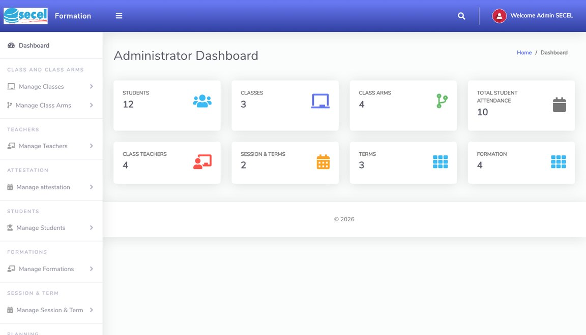

# SECEL Formation

> Application web de gestion d'un centre de formation : formations, planning, formateurs, apprenants, appel quotidien et attestations, avec deux rôles (administrateur et formateur).

**Logiciel** · Terminé · BTS Génie Logiciel · projet de soutenance · centre de formation SECEL

**2 rôles** administrateur et formateur

▶ **[Tester la démo dans le portfolio](https://dorline0121.github.io/#secel-formation)**

## Le projet

J'ai adapté un système open source de gestion des présences (PHP / MySQL) aux besoins du centre SECEL. J'y ai ajouté les formations avec leur prix et leur durée, le planning des sessions, les attestations de formation et l'inscription en ligne. La démo affiche les vraies pages de l'application, enregistrées depuis XAMPP avec ses données de démonstration : connectez-vous en administrateur ou en formateur, ajoutez un apprenant, faites l'appel ou générez une attestation.

## Ce que fait le projet

- Administrateur : formations (prix, durée, classe, lieu), planning des sessions, formateurs, apprenants, sessions et trimestres
- Génération d'une attestation de formation (apprenant, formation, lieu, enseignant, session, mention)
- Formateur : liste de sa classe, appel du jour par cases à cocher, présences par date, taux de présence par apprenant, export CSV
- Listes dépendantes en AJAX : le choix de la classe charge les lieux correspondants
- Inscription en ligne avec mot de passe haché
- Remis en route en 2026 : base de données reconstruite et bugs corrigés pour PHP 8

## Concepts importants

- Architecture PHP / MySQL classique : une page par fonctionnalité, sessions PHP pour les rôles
- Modèle relationnel : classes, lieux, formateurs, apprenants, formations, planning, présences
- Contrôle d'accès par rôle (Administrator / ClassTeacher) à la connexion et sur chaque page
- Accès à MySQL avec mysqli, requête préparée pour le planning ; mots de passe hachés (password_hash pour l'inscription en ligne, md5 hérité du modèle pour les comptes)
- AJAX pour les listes dépendantes sans recharger la page

## Problèmes rencontrés et solutions

**Problème :** Le fichier SQL livré était celui du modèle d'origine : il manquait les tables des formations, du planning et des inscriptions, et toutes les pages concernées plantaient.

**Solution :** Base complète reconstruite à partir des requêtes du code, avec des données de démonstration réalistes.

**Problème :** Sous PHP 8.1, une table manquante déclenche une exception ; comme les pages masquaient les erreurs, on obtenait une page blanche sans message.

**Solution :** Rapport d'erreurs mysqli réglé dans la connexion et cause réelle trouvée en lisant les journaux du serveur.

**Problème :** Le planning ne s'enregistrait jamais : un var_dump() suivi d'un die() de débogage était resté dans le code.

**Solution :** Code de débogage retiré, enregistrement de la classe et du lieu choisis, liste corrigée.

**Problème :** Formations : un champ « Duration » mal nommé et une jointure sur le mauvais identifiant.

**Solution :** Noms de champs alignés avec la base et jointures corrigées.

**Problème :** Le formulaire d'inscription écrivait dans une autre base de données.

**Solution :** Une seule base pour tout le site.

**Problème :** Chemins écrits avec la mauvaise casse (includes/, FORMULAIRE/), tolérés sous Windows mais pas sur un serveur Linux.

**Solution :** Casse harmonisée pour que le site fonctionne sur n'importe quel hébergeur.

## Ce que j'ai appris

- Partir d'un projet existant demande d'abord de comprendre son modèle de données
- Toujours livrer le script SQL à jour avec le code
- Prochaine étape de sécurité : requêtes préparées partout et password_hash à la place de md5
- Ne jamais masquer les erreurs en développement : une page blanche cache la vraie cause
- Tester chaque rôle et chaque formulaire, pas seulement la page d'accueil
- Présenter et défendre un projet devant un jury

## Technologies

`PHP` · `MySQL` · `Bootstrap` · `jQuery` · `AJAX` · `XAMPP`

## Comptes de démonstration

| Rôle | E-mail | Mot de passe |
|---|---|---|
| Administrator | admin@secel.cm | Password@123 |
| ClassTeacher | teacher@secel.cm | pass123 |

## Comment marche la démo

Les pages de `demos/gestion/` sont les vraies pages de l'application PHP, enregistrées pendant qu'elle tournait sous XAMPP (même HTML, CSS et JavaScript). Le petit script `demo-shim.js` remplace le serveur PHP / MySQL (connexion par rôle, formulaires, appel, attestations) pour qu'on puisse la tester sur GitHub Pages. Les modifications sont gardées pendant la session du navigateur. Le fichier `responsive.css` adapte l'affichage aux téléphones et tablettes.

## Fichiers dans ce dépôt

- [`secel-demos.js`](../../secel-demos.js)
- `demos/gestion/`
- [`assets/secel-formation.jpg`](../../assets/secel-formation.jpg)
- [`assets/secel-logo.png`](../../assets/secel-logo.png)

---

English version

## SECEL Formation

> Web app to run a training centre: courses, schedule, trainers, learners, daily attendance and certificates, with two roles (administrator and trainer).

*BTS in Software Engineering · final defence project · SECEL training centre*

I adapted an open-source attendance system (PHP / MySQL) to the needs of the SECEL centre. I added courses with their price and duration, the session schedule, training certificates and online registration. The demo shows the app's real pages, saved from XAMPP with its demo data: log in as administrator or trainer, add a learner, take attendance or generate a certificate.

### What it does

- Administrator: courses (price, duration, class, location), session schedule, trainers, learners, sessions and terms
- Training certificate generation (learner, course, location, teacher, session, grade)
- Trainer: class list, daily roll call with checkboxes, attendance by date, attendance rate per learner, CSV export
- AJAX dependent lists: choosing a class loads its locations
- Online registration with hashed passwords
- Brought back to life in 2026: database rebuilt and bugs fixed for PHP 8

### Key concepts

- Classic PHP / MySQL architecture: one page per feature, PHP sessions for the roles
- Relational model: classes, locations, trainers, learners, courses, schedule, attendance
- Role-based access control (Administrator / ClassTeacher) at login and on every page
- MySQL access with mysqli, a prepared statement for the schedule; hashed passwords (password_hash for online registration, md5 inherited from the template for accounts)
- AJAX for dependent lists without reloading the page

### Problems met and solutions

- **Problem:** The SQL file shipped was the original template's: the course, schedule and registration tables were missing, so every related page crashed.  
  **Solution:** Complete database rebuilt from the code's queries, with realistic demo data.
- **Problem:** On PHP 8.1, a missing table throws an exception; since the pages hid errors, you got a blank page with no message.  
  **Solution:** mysqli error reporting set in the connection, and the real cause found by reading the server logs.
- **Problem:** The schedule was never saved: a debugging var_dump() followed by die() had been left in the code.  
  **Solution:** Debug code removed, the chosen class and location saved, list fixed.
- **Problem:** Courses: a misnamed “Duration” field and a join on the wrong id.  
  **Solution:** Field names aligned with the database and joins fixed.
- **Problem:** The registration form wrote to another database.  
  **Solution:** One single database for the whole site.
- **Problem:** Paths with the wrong case (includes/, FORMULAIRE/), accepted by Windows but not by a Linux server.  
  **Solution:** Case harmonised so the site runs on any host.

### What I learned

- Starting from an existing project means understanding its data model first
- Always ship the up-to-date SQL script with the code
- Next security step: prepared statements everywhere and password_hash instead of md5
- Never hide errors during development: a blank page hides the real cause
- Test every role and every form, not just the home page
- Present and defend a project in front of a jury

---

Dorline TIAKO OKASSIE · [Portfolio](https://dorline0121.github.io) · [GitHub](https://github.com/Dorline0121)
